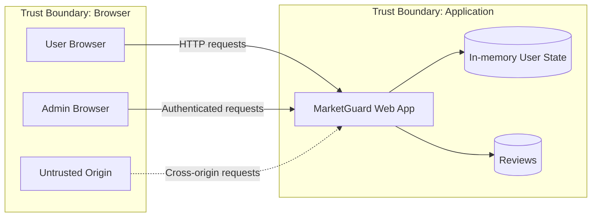

# Threat Model

## Scope

MarketGuard is a small marketplace lab with a browser client, a web application, an authentication/session boundary, profile data, reviews, an administrative API, and a rewards balance.

## Primary assets

- User identity and role
- Email/profile data
- Administrative user listing
- Reward-point balances
- User-generated review content
- Integrity of state-changing requests

## Abuse cases

| ID | Abuse case | Security property |
|---|---|---|
| TM-01 | Inject executable markup through search | Output encoding / injection resistance |
| TM-02 | Persist executable markup in a review | Stored-content safety |
| TM-03 | Forge a state-changing account request | Request integrity / CSRF resistance |
| TM-04 | Modify a role cookie to reach admin functions | Server-side authorization |
| TM-05 | Read sensitive API data from an untrusted origin | CORS / origin policy |
| TM-06 | Submit negative reward redemption values | Business-rule validation |

## Trust decisions

The hardened design follows two rules throughout the project:

1. Browser-controlled values are data, not authority.
2. Business invariants are enforced on the server even when the UI already validates them.
